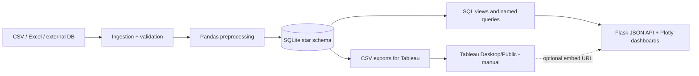
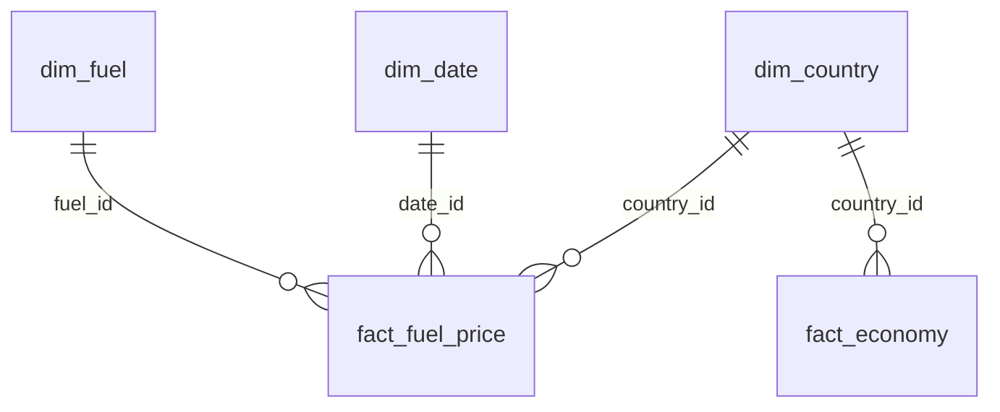

# Project report - Global Fuel Prices, Taxation and Subsidy Trends (2020-2026)

> **Data origin: SYNTHETIC.** Every figure below was measured on simulated data (seed 42). Nothing here describes the real world.

## 1. Objective and personas
An end-to-end analytics platform (Python, SQLite, Flask, Plotly, Tableau specs) for: **A** energy policy consultants (tax, subsidy, equity), **B** supply chain managers (regional prices, volatility, forecasts), **C** energy economics researchers (income, affordability, correlations).

## 2. Architecture

## 3. Data model

Grain: **country x month x fuel type**; natural key unique. Monthly 2020-01..2026-10 = 82 months x 84 countries x 3 fuels = 20,664 defect-free rows.

**Record-count target:** the brief asked for 27,468 records. That equals 84 x 3 x 109 periods; 82 monthly periods cannot reach it, so the target is **not met**. The actual count is reported everywhere; it was not inflated.

## 4. Pipeline steps
1. Generate synthetic raw CSV with documented injected defects (duplicates, negative/missing/extreme values, label variants, date formats) - `data/raw/DATA_PROVENANCE.json`.
2. Ingest as text; validate columns/types; standardise labels; remove exact duplicates; hard-reject impossible rows; impute with documented rules; flag outliers; derive tax share, tax rate, subsidy ratio, affordability.
3. Load SQLite in one transaction with PK/FK/CHECK/UNIQUE constraints and indexes; run SQL validation.
4. Export cleaned CSV, rejected-rows log, quality report, Tableau CSVs.

## 5. Measured results (last verified run)
| Item | Value |
|---|---|
| Source records | 20,724 |
| Exact duplicates removed | 60 |
| Hard-rejected | 27 |
| Extreme prices rejected | 6 |
| Cleaned records | 20,631 |
| Inserted into database | 20,631 |
| Countries / regions / fuel types / income groups | 84 / 7 / 3 / 4 |
| Imputed values | 30 tax, 40 subsidy, 20 GDP |
| SQL validation violations | 0 (duplicates, nulls, ranges, orphans) |
| Preprocess time | ~0.3-0.6 s |
| DB load time | ~0.13-0.17 s |
| Visualizations | 16 (Plotly) |
| Calculated fields (Tableau spec) | 18 |
| Dashboard filters | 5 |
| Tableau story scenes (spec) | 6 (5 required + 1 optional) |
| Automated tests | 70 (all passed in the build sandbox, see Section 8) |
| API latency (in-process, 57 requests) | cold median 19.5 ms, cold max 149.8 ms (volatility), warm median 5.1 ms |

## 6. Findings (synthetic data only)
* Average retail price USD 0.77/L; effective tax burden 25.0%; subsidy-to-price 7.7%.
* Highest average prices: Switzerland (1.73), Netherlands (1.33), Germany (1.29). Lowest: Iran (0.13), Venezuela (0.16), Algeria (0.25).
* Regions by average price: Europe & Central Asia 1.06 highest; MENA 0.37 lowest. Tax burden: Europe 41%, MENA 3.5%. Subsidy ratio: MENA 49%.
* Prices rose to a 2022 peak (petrol 1.17) then eased to ~0.85 (2025-26).
* Affordability (petrol, % of daily income per litre): Low-income 45.0 vs High-income 1.1.
* Country-level correlations (n = 84): price vs tax burden +0.90; price vs subsidy ratio -0.63; price vs affordability -0.01. These are **associations**, partly built into the synthetic generator; they do not show that taxes or subsidies cause price levels.
* Backtest (South Asia petrol, last 6 months): damped Holt MAPE 0.65% vs naive 1.49% - on synthetic data, so it says nothing about real-world forecast skill.

## 7. Calculations
Tax burden = sum(tax)/sum(price); tax rate = tax/(price - tax); subsidy ratio = sum(subsidy)/sum(price); affordability = price/(GDP pc/365); YoY = change in annual average (2026 = Jan-Oct); volatility = coefficient of variation and std of month-over-month % change; forecast = damped Holt with ~95% band and naive baseline (needs >= 24 months).

## 8. Verification status (honest)
* **Executed in the build sandbox:** pipeline, all 70 tests, perf script, page/API checks via Flask's test client.
* **Caveat 1:** the sandbox had no network, so real SQLAlchemy and real pytest could not be installed. Tests ran against a **test-only SQLAlchemy stand-in** (`dev/` in the stage zips, removed from the final) and a minimal pytest-compatible runner. The suite is written for real pytest/SQLAlchemy, but **has not been run with them** - run `python scripts/run_tests.py` on your machine.
* **Caveat 2:** Plotly.js and Bootstrap load from CDN; actual browser rendering of Plotly charts was not verified here (earlier stage checked behaviour with a stub).
* **Caveat 3:** no Tableau workbook exists or was validated; PostgreSQL not tested; `scripts/setup.py` and `scripts/vendor_assets.py` not run end-to-end.

## 9. Limitations
Synthetic data; nominal USD only (no inflation/FX); illustrative income thresholds; stylised cost index; Holt model is simple; subsidy ratio can exceed 100%; partial 2026.

## 10. Recommendations
Replace synthetic data with licensed/official sources and re-run; add inflation-adjusted prices (CPI) and PPP before comparing affordability across time; keep correlation language careful; for larger data use PostgreSQL, pre-aggregated views and indexes on (country, fuel, date); cache aggregates (already done in-process).

## 11. Requirements checklist
Done: pipeline, DB, views, queries, Flask pages and API, 16 charts, filters, tests, docs, Tableau specs, demo script. Manual: Tableau authoring/publishing. Not met: 27,468 records.
